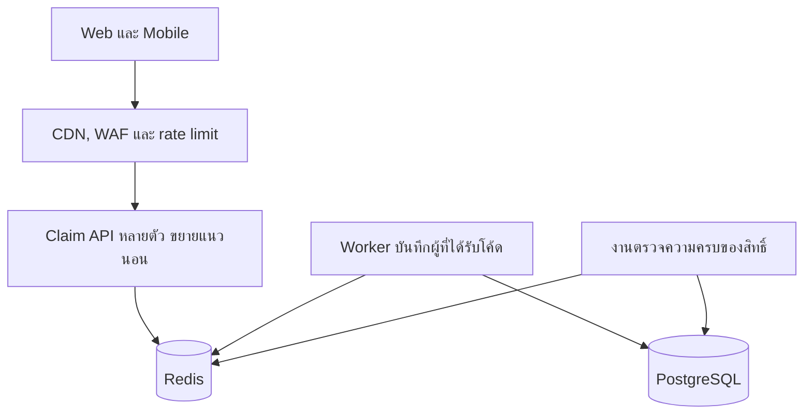

# สถานการณ์ที่ 1 ข้อ 1 — High-Level Architecture

## คำตอบสั้น

ผมแยกคนดูหน้าแคมเปญออกจากคนกดรับโค้ด หน้าเว็บและรูปอยู่บน CDN ส่วนตอนกดรับให้ Claim API ที่ไม่มี state ในตัวเองตัดสินบน Redis ภายในคำสั่งเดียว คลังใน Redis มีโค้ดแค่ 1,000 ใบที่โหลดมาจาก PostgreSQL ก่อนเวลาเปิด ผู้ที่ได้โค้ดเท่านั้นที่ถูกเขียนกลับลง PostgreSQL ผ่าน worker คนที่ไม่ได้โค้ดได้คำตอบจาก Redis ทันทีและไม่แตะฐานข้อมูล

Web กับ Mobile ใช้ API นี้ร่วมกัน จึงมีกติกาเดียวสำหรับทั้งสองช่องทาง

## ตัวเลขที่ใช้กะขนาด

50,000 คนใน 5 นาที ถ้ากระจายสม่ำเสมอคือประมาณ 170 request ต่อวินาที ซึ่งฐานข้อมูลทั่วไปรับไหว แต่ Flash Sale ไม่กระจายสม่ำเสมอ คนมากองที่วินาทีที่นาฬิกาขึ้น 12:00

ผมเลยออกแบบให้รับแรงชนช่วงสั้น ๆ ที่ประมาณ 3,000–5,000 ครั้งต่อวินาที ส่วนคำขอที่สำเร็จทั้งแคมเปญมีเพดาน 1,000 ครั้งเท่านั้น ของที่เหลือเป็นคำตอบว่าหมดแล้ว หรือว่าบัญชีนี้รับไปแล้ว

ข้อสรุปจากการกะขนาดนี้คือของที่ต้องขยายคือชั้นที่ตอบว่า "ไม่ได้รับโค้ด" ไม่ใช่ชั้นฐานข้อมูล

## สมมติฐาน

- ผู้ใช้ล็อกอินก่อนกด และผูกสิทธิ์กับบัญชี ไม่ผูกกับเครื่อง
- โค้ด 1,000 ใบถูกสร้างไว้ใน PostgreSQL ก่อนวันขาย Redis ไม่ได้เป็นคนแต่งโค้ดขึ้นมาเอง
- ทีมมี PostgreSQL อยู่แล้ว และรับ Redis กับ worker อีกตัวได้
- ภาษาของ API ใช้ภาษาที่ทีมดูแลอยู่ได้เลย สิ่งที่ล็อกไว้คือโปรเซสต้องไม่มี state ของสต็อกอยู่ในหน่วยความจำตัวเอง

## ทำไมทางที่ดูตรงไปตรงมาถึงล่ม

ถ้าทุกครั้งที่กดแล้วให้แอปเปิด transaction ไปอ่านแถวโควตาแถวเดียวใน PostgreSQL แล้วค่อยบวกหรือลบ ช่วง 12:00 จะมีหลายพัน connection มาแย่งล็อกแถวนั้น คิวล็อกยาวขึ้น request ค้าง connectio pool เต็ม แล้วระบบอื่นที่ใช้ฐานข้อมูลเดียวกัน เช่น การสั่งซื้อปกติ ช้าไปด้วย

ถ้าหน้าแคมเปญประกอบจากแอปทุกครั้งที่เปิด 50,000 คนจะมาดาวน์โหลดรูปและ HTML จาก origin พร้อมกับคนกดรับโค้ด ทั้งที่หน้านั้นแทบไม่เปลี่ยนระหว่างนับถอยหลัง

ถ้าตัวนับสิทธิ์อยู่ใน memory ของแอปเครื่องเดียว จะกัน race ได้แค่ในโปรเซสเดียว พอขยายเป็นหลายเครื่องตัวเลขก็ไม่ตรงกัน และเครื่องนั้นกลายเป็นจุดเดียวที่พังแล้วทั้งแคมเปญหยุด

## ภาพรวม

ลูกศรจาก API ไปหา PostgreSQL ไม่มีบนเส้นทางที่ผู้ใช้กดรับ นั่นคือหัวใจของแบบนี้

## แต่ละชิ้นทำอะไร

### CDN และ WAF

หน้าแคมเปญ รูป และไฟล์หน้าเว็บถูกเสิร์ฟจาก CDN origin รับแค่ API นาฬิกานับถอยหลังบนหน้าจอเป็นแค่การแสดงผล ถึงเวลาจริงหรือยังให้ API เป็นคนตอบ

WAF ตัดทราฟฟิกที่ผิดปกติออกก่อนเข้าแอป และใส่ rate limit ที่ขอบระบบ ความละเอียดของ limit อยู่ที่ข้อ 2 ร่วมด้วย จุดที่เกี่ยวกับสถาปัตยกรรมคือ limit ต่อ IP ต้องไม่ต่ำเกิน เพราะผู้ใช้มือถือไทยจำนวนมากออกเน็ตผ่าน IP ร่วมของผู้ให้บริการ ถ้าล็อกต่อ IP แรงไปจะไปบล็อกคนจริง ส่วนรายผู้ใช้ล็อกที่ API หลังจากรู้ตัวตนแล้ว

### Load balancer และ Claim API

API เป็นโปรเซส stateless กี่เครื่องก็ได้ เครื่องหนึ่งรับงานเบา ๆ แบบนี้ได้ราวหลักร้อยถึงหลักพัน request ต่อวินาที จึงใช้ประมาณ 6–10 ตัวช่วงเปิดขาย และให้ autoscale จาก CPU กับจำนวน request

การตรวจตัวตนต้องจบในชั้นนี้โดยไม่ยิง PostgreSQL ทุกครั้ง ใช้ access token ที่ตรวจลายเซ็นได้ในโปรเซส หรือเก็บ session ใน Redis ถ้าทุกครั้งที่กดต้องตามไปอ่าน session ใน PostgreSQL ฐานข้อมูลจะรับ 5,000 อ่านต่อวินาทีก่อนจะได้เริ่มแจกโค้ด

### Redis

Redis ตัวหลักหนึ่งตัวกับ replica อีกตัวเพียงพอสำหรับหลักพัน operation ต่อวินาทีของแคมเปญนี้ ยังไม่จำเป็นต้องทำ cluster

ใน Redis มีสี่อย่าง

- สถานะแคมเปญ: `CLOSED`, `OPEN`, `SOLD_OUT`
- คลังโค้ด: list ความยาว 1,000 ที่ถูกแทนที่ทั้งก้อนก่อนเปิดขาย
- ผลของแต่ละบัญชี: คีย์ `campaign + user` เก็บโค้ดที่บัญชีนั้นได้
- outbox: Redis Stream ที่เขียนในคำสั่งเดียวกันกับตอนดึงโค้ดออกจากคลัง เพื่อให้ "จ่ายโค้ด" กับ "มีเหตุการณ์ให้ worker ไปบันทึก" เกิดหรือไม่เกิดพร้อมกัน

บทบาทของ message queue ในแบบนี้คือ Redis Stream ผมไม่แยกคิวไปอีกคลัสเตอร์สำหรับแคมเปญขนาดนี้ เพราะผู้ที่ต้องบันทึกลงฐานข้อมูลมีไม่เกิน 1,000 คน Stream บน Redis ชุดเดียวกับที่จ่ายโค้ดทำให้ไม่มีช่องว่างระหว่างจ่ายโค้ดสำเร็จแต่ลืมส่งคิว ถ้าองค์กรมี Kafka อยู่แล้วจะใช้แทน stream ได้ แต่การส่งคิวจะอยู่นอกคำสั่ง atomic และต้องมีทางเก็บกู้เมื่อส่งคิวไม่สำเร็จ

### Worker และ PostgreSQL

Worker อ่าน stream แล้วอัปเดตแถวโค้ดที่มีอยู่แล้วใน PostgreSQL ว่าถูกมอบให้บัญชีใด มันไม่ได้สร้างโค้ดใหม่ และไม่ได้รับรู้ถึงผู้ใช้ที่กดแล้วไม่ได้โค้ด

พูล connection ของ worker เล็กและคงที่ เช่น ไม่เกิน 5 เพราะทั้งแคมเปญมีงานเขียนประมาณ 1,000 แถว งานเขียนชุดนี้แยกบริการออกจาก API ที่รับคนทั้ง 50,000 เพื่อไม่ให้การเปิดขายไปใช้ connection ของระบบสั่งซื้อจนหมด

PostgreSQL เป็นหลักฐานถาวรว่าโค้ดใบไหนเป็นของบัญชีไหน ระหว่างนาทีที่เปิดขาย Redis เป็นผู้ตัดสิน ส่วนฐานข้อมูลตามทันภายในไม่กี่วินาที หน้า "โค้ดของฉัน" ช่วงแคมเปญจึงต้องอ่านผลจาก Redis ได้ด้วย ไม่งั้นผู้ใช้ได้รับโค้ดแล้วกดรีเฟรชจะเห็นว่ายังไม่มี เพราะแถวในฐานข้อมูลยังมาไม่ถึง

### งานตรวจยอด

ระหว่างและหลังแคมเปญ มีงานเทียบสูตรนี้

`จำนวนโค้ดที่ยังอยู่ในคลัง + จำนวนบัญชีที่ได้รับโค้ดแล้ว = 1,000`

และเทียบกับจำนวนแถวใน PostgreSQL ที่ถูกมอบสิทธิ์แล้ว ถ้าสูตรไม่ลงตัวให้ส่งสัญญาณหาคนเฝ้าแคมเปญ และกดสวิตช์ปิดการจ่ายโค้ดใหม่ได้ทันที สิทธิ์ที่จ่ายไปแล้วต้องยังอ่านได้

## ลำดับเวลาก่อนและตอนเปิด

ก่อน 12:00 โค้ดทั้ง 1,000 ใบอยู่ใน PostgreSQL แล้ว งานเตรียมการลบคลังเก่าใน Redis แล้วใส่โค้ดชุดนี้เข้าไปใหม่ทั้งก้อน การใส่แบบต่อท้ายอันตราย เพราะรันซ้ำจะกลายเป็น 2,000 ใบ เปิดขายได้ต่อเมื่อความยาวคลังเท่ากับจำนวนแถวที่ยังไม่มอบสิทธิ์ในฐานข้อมูลเท่านั้น ถ้าไม่เท่า สถานะค้างที่ `CLOSED`

ตอน 12:00 งานตามเวลาเปลี่ยนสถานะเป็น `OPEN` นาฬิกาโทรศัพท์ของผู้ใช้ผิดได้ ปุ่มบนหน้าจอเป็นแค่ส่วนแสดงผล API เทียบเวลากับ `starts_at` บนเซิร์ฟเวอร์ ถ้ายังไม่ถึงเวลาก็ไม่จ่าย

หลังคลังว่าง สคริปต์ตั้งสถานะเป็น `SOLD_OUT` คำขอถัดไปจบที่ Redis หน้าแคมเปญขึ้นว่าหมดโดยไม่ต้อง deploy

## เมื่อชิ้นส่วนมีปัญหา

พฤติกรรมที่ตั้งไว้  
| Redis ใช้ไม่ได้ | ตอบ 503 และไม่จ่ายโค้ด ไม่เปลี่ยนไปล็อกแถวใน PostgreSQL แทน เพราะนั่นคือเส้นทางที่ตั้งใจเลี่ยงตอนคนท่วม |
| Worker ช้าหรือหยุด | ผู้ใช้ยังได้โค้ดจาก Redis สิทธิ์ไม่ถูกแจกซ้ำ เพราะคีย์ของบัญชีถูกเขียนแล้ว พอ worker กลับมาจะบันทึกต่อจาก stream |
| PostgreSQL ช้า | ผลกระทบอยู่ที่ worker กับระบบอื่นที่แยกพูลไว้ การกดรับยังตอบจาก Redis |
| ตอบ `SOLD_OUT` หรือรับแล้วด้วย HTTP 500 | ห้ามทำ ต้องเป็นผลทางธุรกิจที่อ่านแล้วไม่ยิงซ้ำทั้งก้อน ไม่งั้นแอปและ gateway จะ retry แล้วทวีคูณทราฟฟิกตอนที่ของหมดพอดี |
| ต้องหยุดแคมเปญ | เปลี่ยนสถานะเป็น `CLOSED` การจ่ายใหม่หยุด ผู้ที่ได้รับไปแล้วยังเห็นโค้ดเดิม |

ความคงทนของผลบน Redis ใช้ AOF และ replica ก่อนตอบผู้ใช้ว่ารับสำเร็จ API รอให้ replica รับคำสั่งนั้นทันอย่างน้อยหนึ่งตัวในเวลาสั้น ๆ เช่น 50 มิลลิวินาที หน้าต่างที่เครื่องหลักหายก่อนข้อมูลถึง replica จึงแคบมาก รายละเอียดของคำสั่งกัน race อยู่ในข้อ 2
