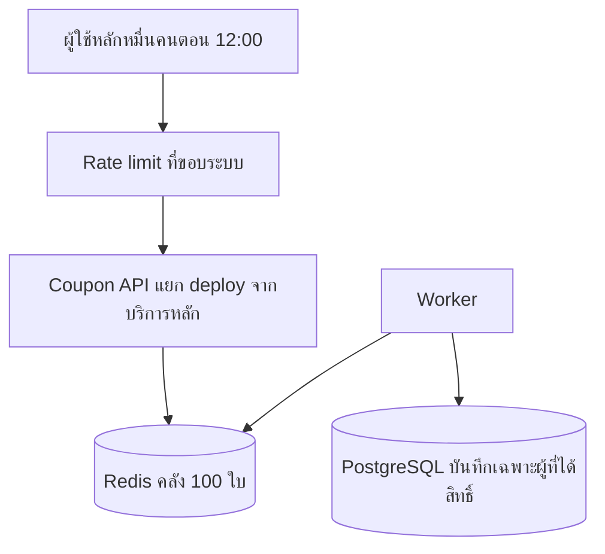

# สถานการณ์ที่ 3 — คูปอง 100 สิทธิ์ คนกดพร้อมกันหลักหมื่น

## คำตอบสั้น

สิทธิ์มี 100 ใบแต่คนกดพร้อมกันหลักหมื่นตอน 12:00 ของจะหมดภายในเสี้ยววินาทีแรก งานของสถาปัตยกรรมคือตอบปฏิเสธคนที่เหลือให้จบโดยไม่เปิด connection ไปที่ PostgreSQL และงานของ logic คือทำให้ใบที่ 101 ถูกสร้างไม่ได้

ผมสร้างคูปอง 100 แถวไว้ใน PostgreSQL ก่อนเปิด โหลดรหัสทั้ง 100 เข้าคลังบน Redis แล้วให้สคริปต์ Lua ใบเดียวเป็นคนมอบสิทธิ์ ผู้ที่ได้สิทธิ์เท่านั้นถูกเขียนกลับลงฐานข้อมูลผ่าน worker เส้นทางที่ผู้ใช้กดไม่มีลูกศรไปหา PostgreSQL

## โจทย์นี้หนักตรงไหน

ต่างจากแคมเปญที่สิทธิ์เป็นหลักพันแล้วคนทยอยเข้าในห้านาที ตรงที่อัตราส่วนคนต่อสิทธิ์สูงมาก และแรงมากองที่วินาทีเปิดทั้งก้อน หลักหมื่นคนพร้อมกันแปลว่าต้องรับแรงชนช่วงสั้นระดับหลายพัน request ต่อวินาที ขณะที่งานเขียนธุรกิจมีแค่ 100 แถว

ถ้าให้ทุกการกดไปอัปเดตแถวคงเหลือในฐานข้อมูล หมื่น connection จะมาแย่งล็อกแถวเดียว พูลเต็ม คำขอค้าง และบริการอื่นที่ใช้ฐานข้อมูลเดียวกันล่มทั้งที่คูปองเหลือแค่ร้อยใบ

## ภาพรวม



Coupon API เป็นคนละ deployment กับ API สั่งซื้อและรายงาน พูล connection ของมันคนละก้อนกับระบบหลัก ต่อให้คนเผลอเขียนให้เส้นทางกดรับไปแตะฐานข้อมูล ความเสียหายก็ไม่กินพูลของทั้งบริษัท และในแบบนี้ตัว handler ของการกดรับไม่มีโค้ดเปิด connection อยู่เลย

## Logic การให้สิทธิ์

ก่อน 12:00 ต้องมีแถวคูปอง 100 แถวใน PostgreSQL และ list ใน Redis ยาว 100 งานโหลดคลังเป็นการแทนที่ทั้งก้อน รันซ้ำแล้วยังได้ 100 ถ้าสองจำนวนนี้ไม่เท่ากัน สถานะแคมเปญจะไม่ถูกเปิด

ตอนกด สคริปต์เดียวบน Redis ทำตามลำดับนี้ การทำงานของ Redis ทำให้ไม่มี request อื่นสอดไประหว่างขั้น

1. ถ้าบัญชีนี้มีผลอยู่แล้ว ให้คืนคูปองใบเดิม แม้ของจะหมดหรือแคมเปญถูกปิด การกดรัวและ retry จึงได้ใบเดิม
2. ถ้าสถานะเป็น `SOLD_OUT` ให้ตอบว่าหมด
3. ถ้าสถานะยังไม่ใช่ `OPEN` ให้ตอบว่ายังไม่เปิด นาฬิกาที่ใช้คือเวลาเซิร์ฟเวอร์
4. ถ้าคลังว่าง ให้ตั้งสถานะ `SOLD_OUT` แล้วตอบว่าหมด
5. ถ้ายังมี ให้ `LPOP` หนึ่งใบ ผูกกับ user id จาก token ที่ตรวจแล้ว และเขียน stream ให้ worker ในสคริปต์เดียวกัน

```lua
-- KEYS[1] = สิทธิ์ของบัญชี
-- KEYS[2] = คลังคูปอง
-- KEYS[3] = สถานะแคมเปญ
-- KEYS[4] = stream ให้ worker
-- ARGV[1] = user id จาก token

local existing = redis.call('GET', KEYS[1])
if existing then
  return {'ALREADY_CLAIMED', existing}
end

local status = redis.call('GET', KEYS[3])
if status == 'SOLD_OUT' then
  return {'SOLD_OUT', ''}
end
if status ~= 'OPEN' then
  return {'NOT_OPEN', ''}
end

local code = redis.call('LPOP', KEYS[2])
if not code then
  redis.call('SET', KEYS[3], 'SOLD_OUT')
  return {'SOLD_OUT', ''}
end

redis.call('SET', KEYS[1], code)
redis.call('XADD', KEYS[4], '*', 'userId', ARGV[1], 'code', code)
return {'GRANTED', code}
```

หลังมี request แรกที่เห็นคลังว่าง โปรเซสของ API จำไว้ในหน่วยความจำสั้น ๆ ว่าแคมเปญนี้หมดแล้ว คำขอของบัญชีที่ยังไม่เคยได้สิทธิ์ในช่วงนั้นตอบ `SOLD_OUT` ได้โดยไม่ต้องเข้าสคริปต์หยิบของ บัญชีที่อาจได้ไปแล้วในช่วงเสี้ยวก่อนหน้ายังอ่านคีย์ของตัวเอง เพื่อไม่ให้ผู้โชคดีกดซ้ำแล้วกลายเป็นว่าหมด

แคชในหน่วยความจำตัวนี้มีอายุสั้น เช่น หนึ่งวินาที แล้วค่อยไปยืนยันสถานะที่ Redis อีกครั้ง มันเป็นตัวลดแรงกระแทกหลังของหมด ไม่ใช่ตัวตัดสินความเป็นเจ้าของคูปอง

## ทำไมถึงแจกเกินไม่ได้

มีสี่ชั้นที่ต้องพังพร้อมกันถึงจะเกิดใบที่ 101

- ของจริงมี 100 แถวใน PostgreSQL ระบบไม่มีทางสร้างรหัสใบใหม่ตอนคนกด
- คลัง Redis ถูกตรวจความยาวก่อนเปิด และหยิบด้วย `LPOP` ซึ่งให้รายการหนึ่งรายการกับผู้เรียกหนึ่งคน
- คีย์ `แคมเปญ + บัญชี` ถูกเขียนในสคริปต์เดียวกับการหยิบ คนเดิมได้ใบเดิม
- ตารางมี unique ที่ตัวรหัส และ unique ที่ผู้ใช้ต่อแคมเปญ worker อัปเดตเฉพาะแถวที่ยังไม่มีเจ้าของ

```sql
update coupons
set user_id = $1, assigned_at = now()
where campaign_id = $2
  and code = $3
  and user_id is null;
```

ข้อความจาก stream ถูกส่งซ้ำได้ ครั้งที่สองอัปเดตไม่ติดเพราะมีเจ้าของแล้ว จำนวนผู้รับไม่เพิ่ม

งานตรวจสูตร `จำนวนที่ยังอยู่ในคลัง + จำนวนบัญชีที่ได้แล้ว = 100` รันถี่ช่วงนาทีแรก ถ้าสูตรไม่ลงตัวให้ตั้งสถานะปิดการจ่ายทันที

## ทำไมฐานข้อมูลถึงไม่ล่ม

- คนที่ไม่ได้คูปองซึ่งเป็นเกือบทั้งหมดของหลักหมื่นคน จบที่ edge, ที่หน่วยความจำของ API หรือที่ Redis
- คนที่ได้คูปองมีได้มากสุด 100 คน และถูกเขียนทีหลังโดย worker ที่ใช้ connection เพียงไม่กี่เส้น
- การตรวจล็อกอินใช้ token ที่ตรวจในโปรเซสได้ ไม่ได้เปิดแถว session ใน PostgreSQL ทุกครั้งที่กด
- ผล `SOLD_OUT` และ `ALREADY_CLAIMED` ถูกตอบเป็นผลธุรกิจปกติ ไม่ใช้ HTTP 500 แอปจึงไม่ระดม retry ใส่ฐานข้อมูลตอนของหมด
- rate limit ที่ขอบระบบกันกรณีมีสคริปต์ยิงรัวกว่าผู้ใช้จริง ส่วนกติกาหนึ่งคนหนึ่งสิทธิ์ยังอยู่ที่สคริปต์ ไม่ได้อยู่ที่ limit

หน้าประกาศแคมเปญกับรูปอยู่บน CDN หลักหมื่นคนที่เปิดหน้ามารอ 12:00 จะได้ไฟล์จากขอบระบบ ไม่มาประกอบหน้าใหม่ที่แอปทุกครั้ง

## ความคงทนและสิ่งที่ผู้ใช้เห็น

ผู้ที่ได้สิทธิ์ได้รับการผูกบัญชีกับรหัสใน Redis ก่อนได้รับคำตอบ และ API รอ replica รับข้อมูลนั้นในช่วงเวลาสั้น ๆ ก่อนตอบ `GRANTED` ถ้าหน้าจอหลุด ผู้ใช้กดใหม่ได้รหัสเดิม

Worker ตามไปเขียน PostgreSQL ทีหลัง หน้าคูปองของฉันช่วงนาทีแรกจึงอ่านจาก Redis ได้ ไม่งั้นผู้ใช้ได้สิทธิ์แล้วรีเฟรชจะยังไม่เห็นแถวในฐานข้อมูล

ถ้า Redis ใช้ไม่ได้ทั้งตัวหลักและ replica ระบบตอบว่าให้ลองใหม่และไม่จ่ายสิทธิ์ การไปพึ่งการล็อกแถวใน PostgreSQL ตอนนั้นจะพาฐานข้อมูลเข้าสู่สภาวะที่แบบนี้ตั้งใจกันไว้

## สิ่งที่ควรซ้อม

- 20,000 บัญชียิงพร้อมกันใส่คลัง 100 ใบ ได้ผู้รับ 100 บัญชี ไม่มีรหัสซ้ำ และ PostgreSQL ถูกเรียกจาก worker ไม่ถูกเรียกจาก request ของคนที่ไม่ได้สิทธิ์
- บัญชีดียิง 30 ครั้งพร้อมกันจาก Web กับ Mobile ได้คูปองใบเดียว
- ตอนสถานะเป็น `SOLD_OUT` จำนวน connection ของ PostgreSQL ไม่ขยับตามจำนวนคนกด
- โหลดคลังสองครั้งก่อนเปิด แล้วยังมี 100 ใบ
- ฆ่า worker แล้วเปิดใหม่ ผู้รับยังครบ 100 โดยไม่เพิ่ม
